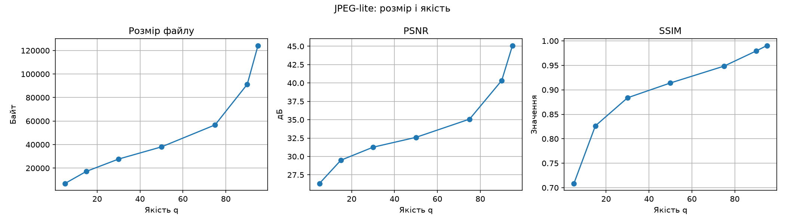
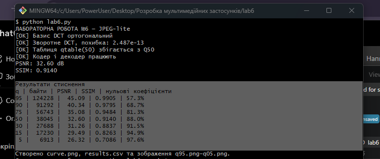

# Лабораторна робота №6 — JPEG-lite

**Дисципліна:** Розробка мультимедійних застосунків

## Мета роботи

Реалізувати спрощений алгоритм JPEG із використанням DCT, квантування та зворотного перетворення. Дослідити залежність розміру й якості зображення від параметра якості.

## Хід роботи

1. Побудовано матрицю базису DCT та реалізовано зворотне перетворення.
2. Реалізовано таблицю квантування для різних рівнів якості.
3. Створено кодер і декодер зображень на основі блоків 8×8.
4. Розраховано PSNR, SSIM і розмір стиснених коефіцієнтів.
5. Побудовано графік залежності розміру та якості від параметра q.
6. Збережено відновлені зображення для порівняння.

## Результати

| Якість q | Розмір, байт | PSNR, дБ | SSIM |
|---:|---:|---:|---:|
| 95 | 124228 | 45.09 | 0.9905 |
| 90 | 91292 | 40.34 | 0.9795 |
| 75 | 56743 | 35.08 | 0.9484 |
| 50 | 38045 | 32.60 | 0.9140 |
| 30 | 27688 | 31.26 | 0.8837 |
| 15 | 17230 | 29.49 | 0.8263 |
| 5 | 6913 | 26.32 | 0.7086 |

За зменшення параметра якості розмір даних скорочується, але погіршуються PSNR і SSIM. Це демонструє компроміс між стисненням та якістю зображення.

## Результат запуску

Графік `curve.png`:

## Скріншот виконання

.

## Висновок

Під час роботи реалізовано основні етапи спрощеного JPEG-кодера. Досліджено вплив квантування на розмір даних, PSNR і SSIM. Встановлено, що сильніше стиснення зменшує обсяг даних, але збільшує втрати якості. Для практичного використання потрібно добирати параметр якості відповідно до призначення зображення.