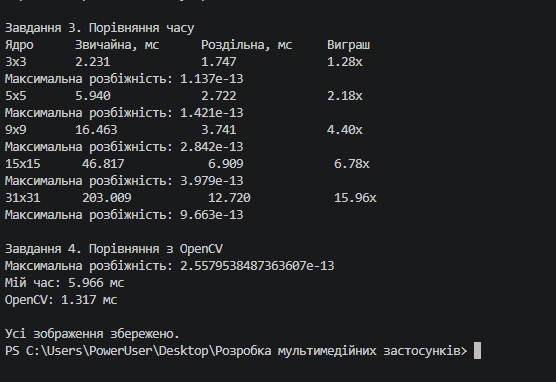

# Лабораторна робота №7. Згортка

## Тема
Згортка та фільтрація зображень за допомогою Python і NumPy.

## Мета
Навчитися реалізовувати згортку зображень, застосовувати фільтри Гауса, Собеля та підвищення різкості, порівнювати звичайну і роздільну згортку, а також досліджувати швидкодію OpenCV.

## Використані технології
- Python
- NumPy
- Pillow
- scikit-image
- OpenCV

## Хід роботи

1. Реалізовано функцію двовимірної згортки `conv2` з обробкою країв зображення.
2. Створено гаусове розмиття, фільтр Собеля та фільтр підвищення різкості.
3. Реалізовано роздільну згортку `conv_sep`.
4. Виміряно час виконання для ядер розміром 3×3, 5×5, 9×9, 15×15 і 31×31.
5. Проведено порівняння результатів і швидкодії з OpenCV.
6. Збережено результати обробки зображення у форматі PNG.

## Результати

- `original.png` — початкове зображення.
- `blur.png` — результат гаусового розмиття.
- `sobel.png` — виділення контурів оператором Собеля.
- `sharp.png` — результат підвищення різкості.

# Лабораторна робота №7. Згортка

## Тема
Згортка та фільтрація зображень за допомогою Python і NumPy.

## Мета
Навчитися реалізовувати згортку зображень, застосовувати фільтри Гауса, Собеля та підвищення різкості, порівнювати звичайну і роздільну згортку, а також досліджувати швидкодію OpenCV.

## Використані технології
- Python
- NumPy
- Pillow
- scikit-image
- OpenCV

## Хід роботи

1. Реалізовано функцію двовимірної згортки `conv2` з обробкою країв зображення.
2. Створено гаусове розмиття, фільтр Собеля та фільтр підвищення різкості.
3. Реалізовано роздільну згортку `conv_sep`.
4. Виміряно час виконання для ядер розміром 3×3, 5×5, 9×9, 15×15 і 31×31.
5. Проведено порівняння результатів і швидкодії з OpenCV.
6. Збережено результати обробки зображення у форматі PNG.

## Результати

- `original.png` — початкове зображення.
- `blur.png` — результат гаусового розмиття.
- `sobel.png` — виділення контурів оператором Собеля.
- `sharp.png` — результат підвищення різкості.

## Висновок скрін

## Висновок

Під час лабораторної роботи реалізовано згортку зображень і досліджено її застосування для різних фільтрів. Роздільна згортка дає змогу зменшити кількість обчислень для гаусового ядра. OpenCV забезпечує швидке виконання операцій завдяки оптимізованій реалізації.