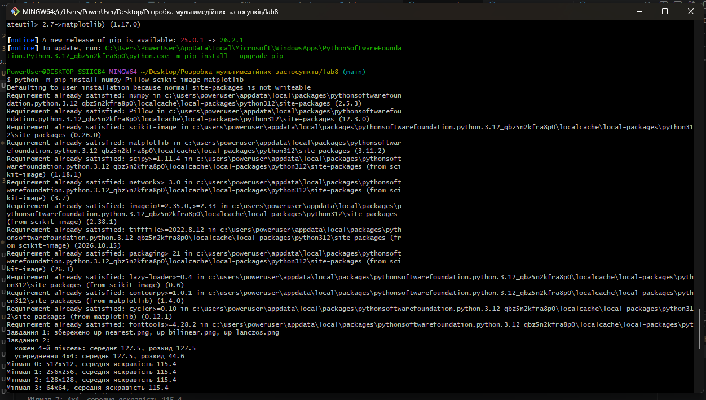
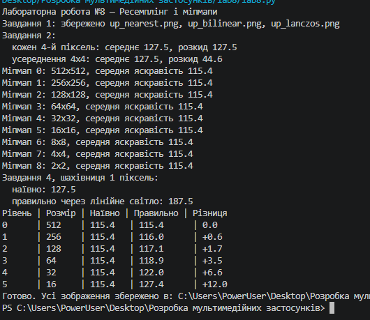

# Лабораторна робота №8 — Ресемплінг і міпмапи

## Тема
Ресемплінг зображень, аліасинг, побудова міпмап і корекція гамми.

## Мета
Дослідити методи збільшення та зменшення зображень, побачити ефект аліасингу, створити ланцюжок міпмап і порівняти усереднення кодів sRGB з усередненням у лінійному світлі.

## Використані засоби
- Python
- NumPy
- Pillow
- scikit-image

## Хід роботи
1. Збільшено фрагмент зображення методами nearest, bilinear і Lanczos.
2. Створено шахівницю під кутом та порівняно прорідження з усередненням блоків 4×4.
3. Побудовано ланцюжок міпмап.
4. Реалізовано перетворення sRGB у лінійне світло та назад.
5. Порівняно наївне й коректне усереднення на шахівниці та фотографії.

## Результати
Програма створює 

## Скріншот запуску

## Висновок
Nearest зберігає різкі межі, але створює помітні квадратні пікселі; bilinear і Lanczos дають плавніше збільшення. Прорідження може спричиняти аліасинг, тоді як усереднення блоків зменшує його. Усереднення в лінійному світлі краще зберігає фізичну яскравість, ніж пряме усереднення кодів sRGB.
